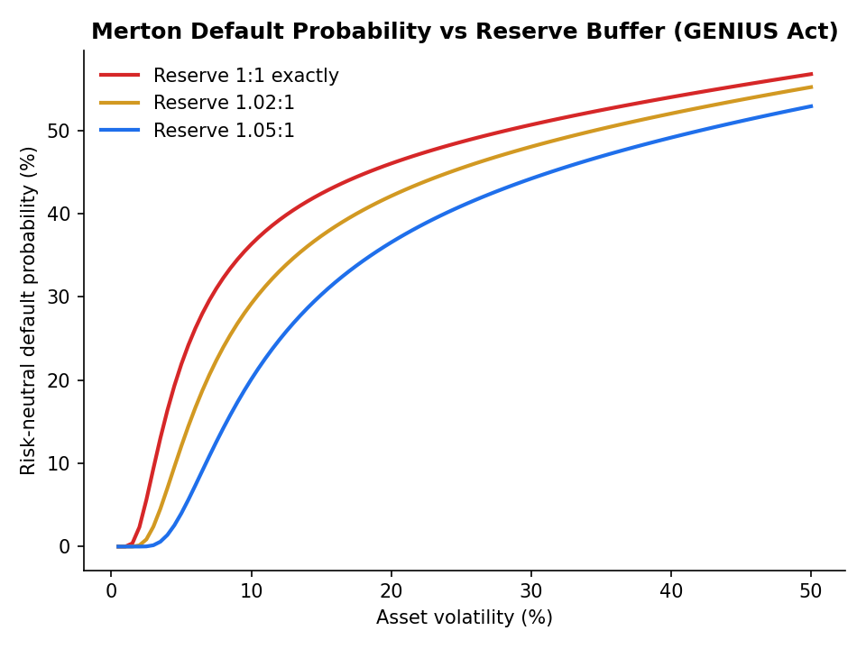
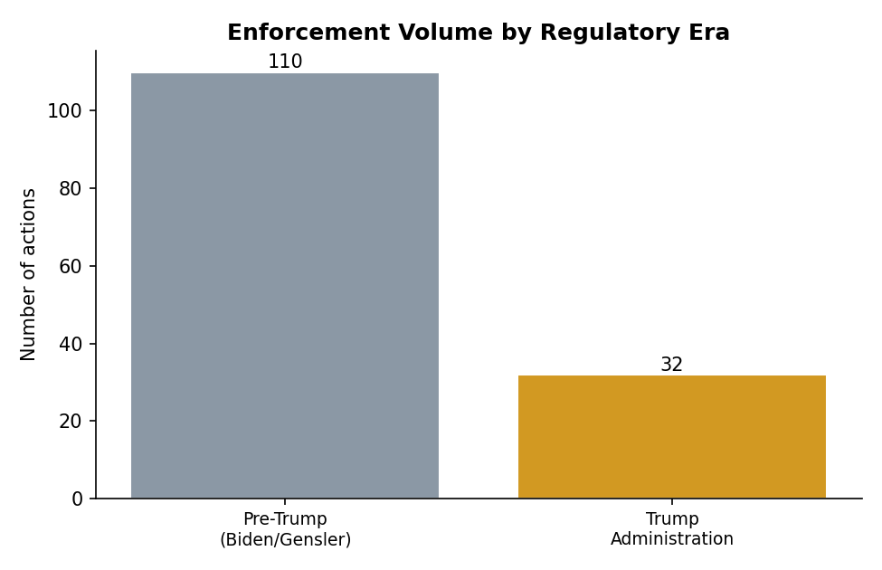
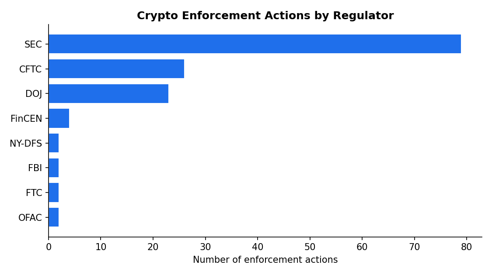

# Payments and Transaction Services: Crypto Enforcement, Credit Risk, and Stablecoin Solvency

A three-part FinTech study spanning regulatory data science, credit-default machine learning, and structural credit-risk analysis of stablecoins under the GENIUS Act.


Author: **Hope Eneojo Ocholi**

---

## Overview

The project has three self-contained sections that together move from regulatory data, to predictive modelling, to structural theory.

**Section 1: Crypto enforcement fines.** A hand-curated database of U.S. crypto-enforcement actions (SEC, CFTC, DOJ, FinCEN, OFAC, NYDFS and others), extended from a 103-record baseline with 40 newly researched and source-verified records spanning February 2024 to February 2026. This deliberately brackets the January 2025 change in federal regulatory posture. The section cleans the free-text fields, engineers analysable categories, runs exploratory analysis across regulators and eras, and fits a decision-tree model.

**Section 2: Credit-default risk.** A full machine-learning pipeline on the "Default of Credit Card Clients" schema: data-quality auditing, behavioural feature engineering, class-imbalance handling, and a nine-model field (logistic regression, random forest, XGBoost, SVM, a deep neural network, LightGBM, CatBoost, a stacking ensemble and a soft-voting blend), with an econometric layer (odds ratios, marginal effects, VIF) and SHAP attributions.

**Section 3: Stablecoin solvency.** The Merton structural credit-risk model applied to a payment-stablecoin issuer under the GENIUS Act of 2025. It formalises the issuer's balance sheet against the Act's 1:1 reserve requirement, derives the equity-as-call-option result, and analyses interest-rate and liquidity risks the Merton model does not capture directly. Delivered as a written report ([`reports/`](reports/)).

## Highlights

The Merton analysis quantifies exactly why a well-reserved stablecoin issuer is structurally different from a levered corporate borrower: default probability stays negligible until asset volatility rises well beyond what a 1:1 short-Treasury reserve would experience.



The enforcement database captures the regulatory-posture shift the sample was designed to bracket.





## Repository layout

```
.
├── src/                     # Reusable, tested analysis library
│   ├── crypto_fines.py      # Fine parsing, entity/outcome/era classification
│   ├── credit_risk.py       # Credit-card cleaning + behavioural features
│   └── merton.py            # Merton model: equity-as-call, PD, distance to default
├── notebooks/               # Combined Section 1 + Section 2 analysis notebook
├── reports/                 # Section 3 (Merton/GENIUS) and combined PDF reports
├── data/                    # The crypto enforcement fines dataset (CSV)
├── figures/                 # Summary charts generated from the data and models
├── tests/                   # pytest suite (17 tests)
├── docs/                    # Section notes and data dictionary
├── requirements.txt
└── README.md

```

### Using the library directly

```python
import pandas as pd
from src.crypto_fines import clean_fine, tag_era
from src.merton import merton_default_probability

# Parse a free-text fine into USD millions
clean_fine("$1.2 billion")      # 1200.0
tag_era("1-Jun-25")             # "Trump Administration"

# Risk-neutral default probability of a 1.02:1-reserved issuer at 4% asset vol
merton_default_probability(asset_value=1.02, debt_face=1.00, r=0.04, sigma=0.04, T=1.0)
```

## The models and methods

- **Fine-amount parser** that preserves the distinction between "no monetary fine reported" (missing) and "explicitly zero paid" (0.0) — a distinction that matters for the dismissal-rate analysis.
- **Entity, outcome and era classifiers** turning free text into analysable categories, including a rule that separates named respondents from policy and legislative events.
- **Behavioural credit features** — utilisation ratio, months delinquent, average payment delay, and a six-month payment-to-bill ratio — that make repayment behaviour explicit to the models.
- **Merton structural model** — equity as a call on assets, distance to default, risk-neutral default probability, and the implied credit spread.

See [`docs/SECTIONS.md`](docs/SECTIONS.md) for a section-by-section walkthrough and [`docs/DATA.md`](docs/DATA.md) for the enforcement-database data dictionary.

## Data provenance and honest caveats

The enforcement records were individually cross-checked against a primary regulatory source (SEC.gov, CFTC.gov, Justice.gov, FinCEN.gov, NYDFS press releases) and a reputable secondary source, with two originally illustrative composites replaced by fully verified named cases. Section 2 uses the publicly archived "Default of Credit Card Clients" dataset as the closest peer-reviewed analogue to the target prediction problem; the pipeline is written against named feature groups rather than dataset-specific column names, so the data source is substitutable. Section 3 is grounded in the actual text of the GENIUS Act and its 2026 implementing rulemakings.

## License

Code is released under the MIT License. See [`LICENSE`](LICENSE). The written reports are the author's academic work and are included for portfolio reference.
